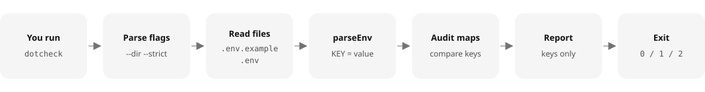

# dotcheck

**A CLI that answers one question:** does this project’s `.env` match `.env.example`?

Clone a repo, forget a key, leave `API_KEY=` blank, or sneak in an extra `DEBUG` flag - **dotcheck** will catch it in CI before the app crash.

```bash
npx tsx src/cli.ts --dir .
# or after build:
node dist/cli.js --dir .
```

---

## How the finished tool flows?

<p align="center">
  
</p>

1. **Flags:** `--dir`, `--example`, `--env`, `--strict`, `--help`
2. **Load:** `.env.example` is required (the contract). Missing `.env` is treated as empty (fresh clone).
3. **Parse:** `KEY=value` lines; `# optional` on the line above marks a key as optional. Comments and blanks are skipped.
4. **Audit:** missing, empty, unused. Required issues fail; unused / optional issues are warnings unless `--strict`.
5. **Report:** names and kinds (`ERROR missing API_KEY`), never values.
6. **Exit:** GitHub Actions / any CI can fail the job.

---

## Why it works this way

Design choices are recorded in [ADR 0001](docs/adr/0001.md).

---

## Install & run

**From this repo**

```bash
git clone https://github.com/parshipcy/dotcheck.git
cd dotcheck
npm install
npm run build
node dist/cli.js --help
```

**On your machine (after `npm link` in this repo)**

```bash
dotcheck --dir path/to/your/app
dotcheck --dir path/to/your/app --strict
```

**Dev (no build)**

```bash
npm start -- --dir .
npm test
```
